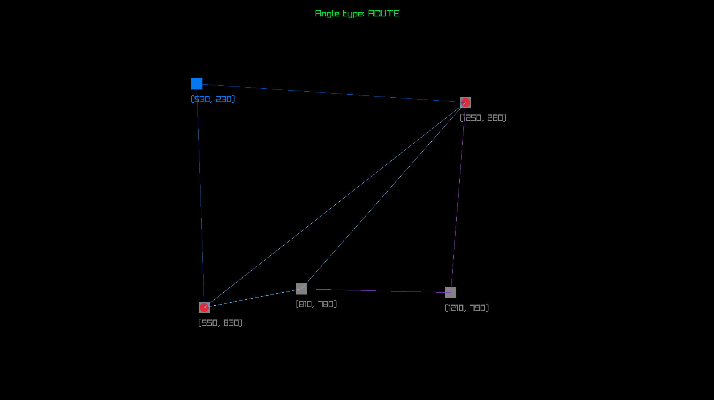

# A polygon triangulation demo made in odin

Small odin program that splits a hard-coded polygon into the least amount of triangles (n-2 triangles where n is the number of vertices).

Tested with odin version dev-2026-04

Either run the precompiled linux binary (./polygon-triangulation-demo) or run `odin run .` if you have the odin compiler installed to compile and run it.

